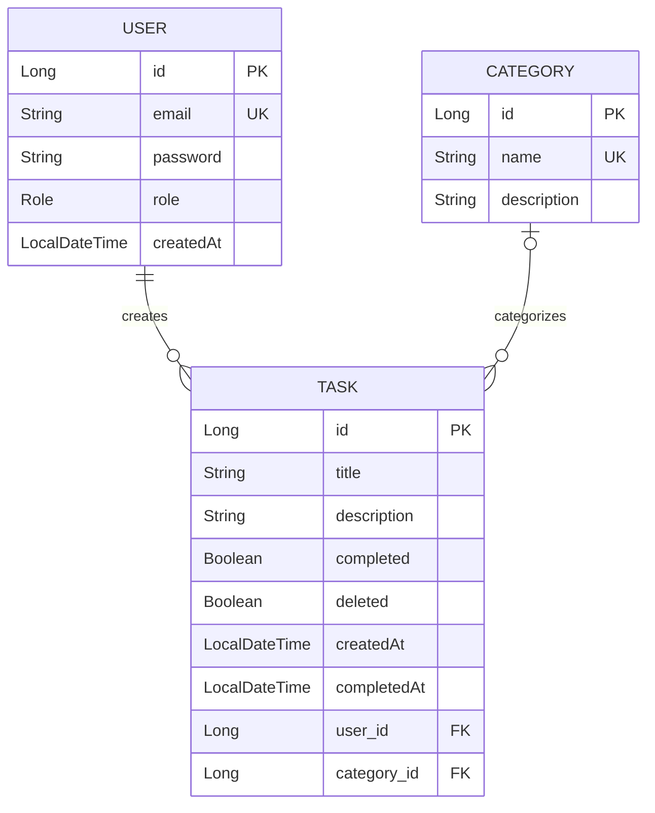
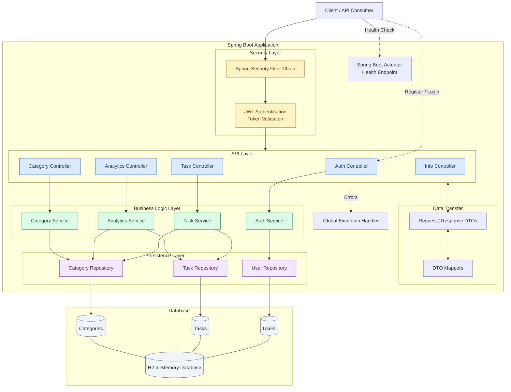

# Flowstate

**A Focus and Productivity Intelligence Platform**

Flowstate is a backend-focused productivity platform designed to help users organize their work, track task completion, and gain insights into their productivity. I also implemented Swagger UI to make it easier to test the application.

Rather than focusing solely on task management, Flowstate aims to connect task completion with actual time spent working, eventually helping users understand not just what they accomplish, but how they spend their time accomplishing it.

The application is built with Java and Spring Boot, following a layered architecture with an emphasis on security, maintainability, data integrity, and reliable API design.

---

### Interactive API Documentation (Swagger UI)

Flowstate integrates Swagger UI through Springdoc OpenAPI, providing interactive API documentation that makes it easier for reviewers and developers to explore and test the REST API.

- Browse available API endpoints and inspect request/response schemas.
- Execute API requests directly from the browser.
- Authenticate using JWT bearer tokens to test protected endpoints.
- Explore authentication, task management, category management, and analytics APIs.

**Access:** `http://localhost:8080/swagger-ui/index.html`

**Port Configuration:** Flowstate uses port `8080` by default. If port `8080` is already occupied on your machine, change the port by adding the following property to `src/main/resources/application.properties`:

```properties
server.port=8081
```

Replace `8081` with any available port. After restarting the application, access Swagger UI at:

`http://localhost:8081/swagger-ui/index.html`

Note: Task categories are optional. To create a task without a category, simply remove the categoryId field from the JSON request body when testing POST /api/v1/tasks. You can also explicitly set "categoryId": null.

---

## Project Status

**Under active development.**

The current implementation provides user authentication, task management, category organization, and productivity analytics through a RESTful API.

Development is progressing incrementally, with a focus on backend architecture, application security, data management, performance, and automated testing.

Future development will expand Flowstate's productivity-tracking capabilities through focus session management, time-based analytics, caching, and additional performance optimizations.

---

## Features

### Authentication and Security

- User registration and login.
- JWT-based authentication using HS256.
- Password hashing with BCrypt.
- Stateless authentication.
- User-specific resource ownership.
- Protected API endpoints.

### Task Management

- Create, retrieve, update, and delete tasks.
- Soft deletion to preserve existing records.
- Task completion tracking.
- Completion timestamps.
- Category assignment.
- Pagination, sorting, and filtering.
- Search tasks by title and completion status.

### Category Management

- Create and retrieve task categories.
- Category assignment to tasks.
- Database-level category name uniqueness.
- Support for uncategorized tasks.

### Productivity Analytics

- Overall task statistics.
- Completed and pending task counts.
- Task completion rates.
- Daily productivity summaries.
- Weekly productivity summaries.
- Category-based productivity breakdowns.

### Application Reliability

- Centralized exception handling.
- Request validation.
- Validated application configuration.
- Automated unit and integration testing.
- Spring Boot Actuator health endpoint configuration.

---

## Technology Stack

| Technology           | Purpose                          |
| -------------------- | -------------------------------- |
| Java 21              | Primary programming language     |
| Spring Boot 4        | Application framework            |
| Spring Web MVC       | REST API development             |
| Spring Security      | Authentication and authorization |
| Spring Data JPA      | Data persistence                 |
| Hibernate            | Object-relational mapping        |
| H2 Database          | In-memory database               |
| Maven                | Dependency and build management  |
| JWT                  | Stateless authentication         |
| BCrypt               | Password hashing                 |
| JUnit 5              | Automated testing                |
| Mockito              | Mocking and unit testing         |
| Spring Boot Actuator | Application health monitoring    |

---

## Architecture

Flowstate follows a layered architecture that separates HTTP handling, business logic, persistence, and data representation.

| Layer      | Responsibility                                          |
| ---------- | ------------------------------------------------------- |
| Controller | Handles HTTP requests, responses, and endpoint routing. |
| Service    | Implements business logic and application rules.        |
| Repository | Handles database access through Spring Data JPA.        |
| Entity     | Represents persistent domain objects.                   |
| DTO        | Defines request and response structures.                |
| Mapper     | Converts between entities and DTOs.                     |
| Config     | Configures application properties and security.         |

### Key Engineering Decisions

**1. Stateless Authentication**

JWT authentication allows clients to authenticate requests without maintaining server-side HTTP sessions.

**2. User Ownership Isolation**

Task retrieval, modification, and deletion operations are restricted to the authenticated user's records.

**3. Soft Deletion**

Tasks are marked as deleted rather than physically removed, preserving records while excluding them from normal queries and analytics.

**4. DTO-Based API Design**

Request and response DTOs separate the public API contract from internal database entities.

**5. Centralized Exception Handling**

Application exceptions and validation errors are handled centrally to provide consistent HTTP responses.

**6. Layered Architecture**

Controllers, services, and repositories have distinct responsibilities, making the application easier to maintain and extend.

---

## API Documentation

Base path: `/api/v1`

### Authentication

| Method | Endpoint         | Description                   |
| ------ | ---------------- | ----------------------------- |
| POST   | `/auth/register` | Register a new user           |
| POST   | `/auth/login`    | Authenticate and obtain a JWT |

### Tasks

| Method | Endpoint                    | Description                       |
| ------ | --------------------------- | --------------------------------- |
| GET    | `/tasks`                    | Retrieve paginated tasks          |
| GET    | `/tasks/{id}`               | Retrieve a specific task          |
| POST   | `/tasks`                    | Create a task                     |
| PUT    | `/tasks/{id}`               | Update a task                     |
| DELETE | `/tasks/{id}`               | Soft-delete a task                |
| GET    | `/tasks/search`             | Search and filter tasks           |
| GET    | `/tasks/completed/{status}` | Filter tasks by completion status |
| GET    | `/tasks/search-by-title`    | Search tasks by title             |

### Categories

| Method | Endpoint              | Description         |
| ------ | --------------------- | ------------------- |
| GET    | `/categories?id={id}` | Retrieve a category |
| POST   | `/categories`         | Create a category   |

### Analytics

| Method | Endpoint                | Description                              |
| ------ | ----------------------- | ---------------------------------------- |
| GET    | `/analytics/overview`   | Retrieve overall productivity statistics |
| GET    | `/analytics/daily`      | Retrieve daily completion statistics     |
| GET    | `/analytics/weekly`     | Retrieve weekly productivity statistics  |
| GET    | `/analytics/categories` | Retrieve category-based statistics       |

### Application Information

| Method | Endpoint | Description                      |
| ------ | -------- | -------------------------------- |
| GET    | `/info`  | Retrieve application information |

### Health Monitoring

| Method | Endpoint           | Description                        |
| ------ | ------------------ | ---------------------------------- |
| GET    | `/actuator/health` | Retrieve application health status |

Authenticated endpoints require a valid JWT in the Authorization header:

`Authorization: Bearer <your-token>`

---

## Getting Started

### Prerequisites

- Java 21
- Maven 3.9 or later
- Git

### 1. Clone the Repository

```bash
git clone https://github.com/ZweYanNaingAung007/Flowstate-Private.git
cd Flowstate-Private
```

The repository is currently public.

### 2. Configure the JWT Secret

The application requires a Base64-encoded JWT secret supplied through the `JWT_SECRET` environment variable.

For PowerShell:

```powershell
$rng = [Security.Cryptography.RandomNumberGenerator]::Create()
$bytes = New-Object byte[] 32
$rng.GetBytes($bytes)
$env:JWT_SECRET = [Convert]::ToBase64String($bytes)
$rng.Dispose()
```

This generates a random 256-bit secret for local development.

**Testing configuration:** Tests use a separate dummy JWT secret defined in `src/test/resources/application.properties`. This allows the test suite to run independently without requiring the application-level `JWT_SECRET` environment variable.

The test secret is intended exclusively for automated testing. Never reuse it in a production environment or commit real application secrets to version control.

### 3. Run the Application

```bash
mvn spring-boot:run
```

The application runs on:

`http://localhost:8080`

### 4. Run the Tests

```bash
mvn clean test
```

Tests use the dedicated test configuration and do not require an externally configured JWT secret.

---

## Database

Flowstate currently uses an H2 in-memory database.

This provides a lightweight database environment for development and testing without requiring an external database server.

**Current limitation:** Data is not persistent across application restarts.

A migration to PostgreSQL is planned for a future development stage.

---

## Testing

Flowstate includes automated unit and integration tests covering:

- Authentication and registration.
- Task operations and ownership isolation.
- Category management.
- Analytics calculations.
- JWT generation.
- Application information.
- Validation and exception handling.

**Current test suite: 61 passing tests.**

---

## Entity Relationship Diagram

The following diagram illustrates the relationships between Flowstate's database entities.



---

## System Architecture

Flowstate follows a layered architecture that separates API handling,
business logic, data transfer, and persistence.



---

## Planned Development

The following improvements are planned for future development.

### 1. Focus Session Management

Introduce focus sessions associated with individual tasks.

Planned capabilities:

- Start, pause, resume, and complete focus sessions.
- Associate sessions with specific tasks.
- Record session start and end times.
- Track actual focused duration.
- Maintain a history of completed sessions.

### 2. Focus Duration Analytics

Extend existing productivity analytics beyond task completion.

Planned insights:

- Daily and weekly focused hours.
- Average focus session duration.
- Total time spent on individual tasks.
- Focus session frequency.
- Comparisons between task completion and actual focused time.

### 3. Caching

Introduce caching to reduce repeated database queries and improve response times.

Potential applications:

- Cache frequently accessed category information.
- Cache suitable productivity statistics.
- Reduce repeated retrieval of relatively stable application data.
- Implement cache invalidation when underlying task or category data changes.

Caching strategies will be evaluated based on actual usage patterns and performance requirements.

### 4. API Rate Limiting

Introduce request limits to protect API resources and reduce abusive traffic.

Potential applications:

- Restrict excessive login attempts.
- Apply request limits to authentication endpoints.
- Prevent individual clients from overwhelming API resources.

### 5. Persistent Database Storage

Migrate from H2 in-memory storage to PostgreSQL to support persistent user and application data.

### 6. Database and Query Optimization

Improve database performance as application usage grows.

Potential improvements:

- Introduce appropriate database indexes.
- Optimize analytics queries.
- Reduce unnecessary database access.
- Evaluate query performance under larger datasets.

### 7. Expanded Monitoring and Deployment

- Expand monitoring beyond basic health checks.
- Introduce additional application metrics.
- Containerize the application with Docker.
- Prepare the application for deployment.

---

## Current Limitations

- Uses an in-memory H2 database; data does not persist across application restarts.
- Category management currently supports creation and retrieval only. Category updates and deletion are not yet implemented.
- Categories are currently shared globally rather than owned by individual users.
- No focus session or duration tracking yet.
- No API rate limiting yet.
- No caching layer yet.
- No frontend application.
- No production deployment configuration.

These limitations represent features are currently being implemented. They will be implemented in a couple of weeks or more

---

## Acknowledgements

Flowstate was initially based on the LeetJourney Task Manager. The original implementation has been substantially modified and extended.

## Major Contributions

Implemented JWT-based authentication and Spring Security.

Added user-specific task ownership and resource isolation.

Introduced soft deletion and task completion timestamps.

Developed productivity analytics and reporting endpoints.

Expanded validation, exception handling, and automated testing.

Improved API documentation and application configuration.

## Licensing

The original LeetJourney Task Manager code used as the starting point for Flowstate is licensed under the [Creative Commons Attribution-NonCommercial 4.0 International License (CC BY-NC 4.0)](https://creativecommons.org/licenses/by-nc/4.0/).

Flowstate contains substantial modifications and additional functionality. The original license continues to apply to the material derived from that project.
